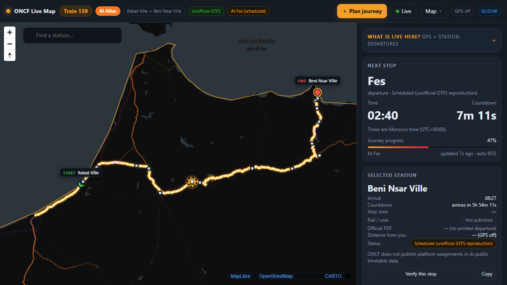

# ONCF Live Map

A Morocco rail tracker: scheduled stop times, **live station departure boards**
and a rich interactive map.

All runtime ONCF API traffic goes through the private gateway:

```text
https://shortora.duckdns.org/oncf
```

The app never calls the upstream data host directly. This repository contains
only the gateway client; the upstream extraction and research notes are kept in
a separate private repository.



## Highlights

- **Map-first interface** — opens on the map, with a compact **Plan / Live /
  Map** toolbar.
- **Live station departures** — real departure times, delay minutes and delay
  level, refreshed every 60 seconds.
- **Journey planner** — city or station autocomplete, popular routes, nearest
  station, recent routes, direct-train preselection.
- **Selected trip ribbon** — white/amber glowing route, animated direction
  dashes, green **Start** / red **End** markers, travelled portion filled amber.
- **Night map** — dark vector map by default, with a Classic Leaflet map and
  satellite/streets/terrain styles available.
- **Traffic notices** — official works/service notices from the gateway.
- **Station search, stops, dwell times, GPS, proximity alerts and fullscreen.**

## Live departures

```bash
python -m oncf departures --station 231
```

The sidebar card:

- auto-fills with the journey origin and refreshes every 60 s;
- highlights your train with an amber border;
- has a **Near me** GPS shortcut and quick chips for Rabat Ville, Casa
  Voyageurs, Marrakech and Fès;
- serves the last disk cache in `--offline` mode.

This is a **station board**, not a train GPS feed. The app never claims a live
position between stations.

## Install and run

```bash
python -m pip install -r requirements.txt
python -m oncf live --port 8767
```

Open <http://127.0.0.1:8767>.

Defaults already point at the gateway. Override only if needed:

```bash
set ONCF_BASE_URL=https://shortora.duckdns.org/oncf
set ONCF_MOBILE_BASE=https://shortora.duckdns.org/oncf
```

Jump straight into a trip:

```bash
python -m oncf live --train MA --from 200 --to 490 --date 2026-11-27 --official-station 380
```

## CLI

```bash
python -m oncf stations --search Rabat
python -m oncf search --from 200 --to 490 --date 2026-11-27
python -m oncf stop --train MA --from 200 --to 490 --station 380 --date 2026-11-27
python -m oncf departures --station 231
python -m oncf sources
```

## Gateway

Only these read paths are used under `/oncf`:

| Path | Purpose |
|---|---|
| `POST /api/schedule` | station-to-station timetables |
| `GET /cache/stations`, `/cache/cities`, `/cache/getServerTimeZone` | reference data |
| `POST /mobile/DepartingTrains` | live station board |
| `POST /mobile/schedule` | mobile timetable |
| `GET /media/CMS/{fr,ar,en}/news` | traffic notices |
| `GET /media/CMS/{fr,ar,en}/pages` | timetable/notices fallback |
| `GET /media/static/...` | timetable PDFs |
| `GET /info-travaux` | official works page |

The gateway is read-only, rate-limited and makes its own TLS connection
upstream. No upstream hostnames, keys or cookies are part of this repository.

## Map

The default **Vector** engine uses MapLibre GL and a dark **Night** style:

- full Morocco network, stations, bilingual labels;
- selected journey ribbon with progress fill and direction dashes;
- station finder, scale, fullscreen, GPS;
- **Focus trip** dims the background network.

The **Classic** engine uses Leaflet with Night (Esri imagery + dark tint),
Satellite, Streets and Terrain. **3D map** adds pitch and building extrusions.
See [`docs/MAP_RESEARCH.md`](docs/MAP_RESEARCH.md) for the key-free map survey.

## Honesty

- Live **station departure times and delay levels** are real.
- Train positions between stations, per-stop real times, platforms/voie and
  structured cancellations are **not published**. The orange map marker is a
  timetable estimate.
- The phone's GPS is live and stays on the device.
- ONCF data belongs to ONCF. This gateway is for personal/interoperability use;
  do not resell or redistribute the raw feed. The community GTFS feed remains
  ODbL.

## Tests

```bash
python -m pytest -q
```

100 tests cover stop calculations, timezone quirks, GTFS, live departure
parsing/caching, route-shape fallback, works notices and source health. Tests
that require official fixtures skip automatically when the fixtures are absent.

## Project layout

```text
oncf/
  api.py            timetable client through the gateway
  mobile.py         live station departures + 45 s cache
  traffic.py        works/service notices
  sources.py        gateway health checks
  live.py           local HTTP server + UI
  web/              MapLibre/Leaflet map, live panel, Night style
docs/
  MAP_RESEARCH.md   key-free map stack survey
```

## Private original

The full upstream extraction, source report, legacy notes and historical
research live in a separate **private** repository. This public repository is
intentionally limited to the gateway version.
